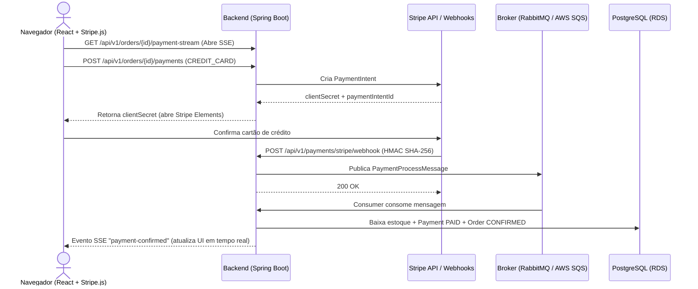

# 💎 MCPRATA ERP — Backend & Cloud Infrastructure


Plataforma corporativa **ERP** para gestão comercial (atacado e varejo) de joias em Prata, construída com **Kotlin + Spring Boot 3**, **arquitetura hexagonal de mensageria** (RabbitMQ local / Amazon SQS em produção), **pagamentos assíncronos via Stripe + Server-Sent Events (SSE)**, **Infraestrutura como Código (Terraform)** e **deploy automatizado na AWS (CI/CD)**.

> 🔗 **Repositório Frontend (React 19 + TypeScript + Vite + Tailwind):** [`mcpratapp-frontend`](https://github.com/Zambrinn/mcpratapp-frontend)  
> 🌐 **Aplicação em Produção (CloudFront CDN):** `https://djvx3ki2joq2t.cloudfront.net`  
> 📖 **Documentação Interativa (Swagger UI):** `/swagger-ui.html` (OpenAPI JSON em `/api-docs`)

---

## 📋 Índice

1. [Visão Geral & Funcionalidades](#-visão-geral--funcionalidades)
2. [Stack Tecnológica](#-stack-tecnológica)
3. [Arquitetura de Software & Mensageria](#-arquitetura-de-software--mensageria)
4. [Arquitetura de Nuvem (AWS) & FinOps](#-arquitetura-de-nuvem-aws--finops)
5. [Infraestrutura como Código (Terraform)](#-infraestrutura-como-código-terraform)
6. [Pipelines de CI/CD (GitHub Actions)](#-pipelines-de-cicd-github-actions)
7. [Segurança & Governança](#-segurança--governança)
8. [Mapa de Endpoints da API](#-mapa-de-endpoints-da-api)
9. [Como Rodar Localmente](#-como-rodar-localmente)
10. [Variáveis de Ambiente](#-variáveis-de-ambiente)
11. [Estrutura do Projeto](#-estrutura-do-projeto)
12. [Autor](#-autor)

---

## 🚀 Visão Geral & Funcionalidades

O **MCPRATA ERP** gerencia todo o ciclo comercial de vendas, estoque, precificação por vendedor e faturamento:

* **Gestão de Usuários & RBAC:** Perfis `ADMIN` e `VENDOR`, paginação com busca dinâmica, **Soft Delete** (`UserStatus.DELETED`) preservando integridade referencial e auditoria de vendas, e revogação imediata de sessões (`RefreshToken`).
* **Catálogo de Produtos & Categorias Reais:** Entidade relacional `Category` (com seeder inicial automático e prefixo de SKU), controle de estoque total vs. reservado (`totalQuantity` / `reservedQuantity`), proteção contra desativação de categorias em uso e precificação personalizada por vendedor (`ProductVendor`).
* **Máquina de Estados de Pedidos (`Order`):**
  * Criação de venda, adição/edição/remoção de itens em pedidos `PENDING` com **reserva e estorno atômico de estoque**.
  * Desconto promocional com regra de negócio de **teto máximo de 20%**.
  * Ciclo de vida controlado: `PENDING` ➔ `CONFIRMED` ➔ `DELIVERED` (ou `CANCELED` com devolução automática do estoque reservado).
* **Esteira de Pagamentos Assíncronos (Stripe + Broker + SSE):**
  * Suporte a `CREDIT_CARD` (Stripe PaymentIntent + Elements), `PIX`, `TICKET` e `MONEY`.
  * Validação criptográfica HMAC SHA-256 nos webhooks da Stripe com deserialização resiliente em 3 níveis.
  * Processamento desacoplado via fila (RabbitMQ em dev / Amazon SQS + DLQ em prod) e notificação em tempo real para o navegador via **Server-Sent Events (SSE)**.
* **Dashboard & Relatórios Gerenciais:** KPIs de faturamento, ticket médio, ranking de produtos mais vendidos, performance por vendedor e relatórios filtráveis por período, cliente, vendedor e status.

---

## 🛠️ Stack Tecnológica

| Camada | Tecnologias |
| :--- | :--- |
| **Linguagem & Runtime** | Kotlin `2.2.21` · Java `21` (Eclipse Temurin) |
| **Framework** | Spring Boot `3.4.3` (Web, Data JPA, Security, Validation, AMQP) |
| **Banco de Dados** | PostgreSQL `15/16` · Hibernate `6.6` · HikariCP |
| **Mensageria** | RabbitMQ (Dev) · Amazon SQS + DLQ via `spring-cloud-aws-starter-sqs:3.3.0` (Prod) |
| **Pagamentos & Real-Time** | Stripe Java SDK `28.2.0` · Server-Sent Events (`SseEmitter`) |
| **Autenticação & Segurança** | JWT Stateless (`jjwt 0.12.5`) · Refresh Tokens · BCrypt · Rate Limiting |
| **Documentação API** | SpringDoc OpenAPI `2.8.5` (Swagger UI + Bearer Auth) |
| **Containerização** | Docker Multi-Stage Build (non-root user `spring`) · Docker Compose |
| **Cloud & IaC** | AWS (ECS Fargate, ECR, RDS, SQS, S3, CloudFront, Lambda, EventBridge, IAM, CloudWatch) · Terraform `>= 1.5` |
| **CI/CD** | GitHub Actions (`ci.yml`, `cd.yml`, `terraform.yml`) |

---

## 🧩 Arquitetura de Software & Mensageria

### Arquitetura Hexagonal de Mensageria (Ports & Adapters)
O domínio de pedidos não depende diretamente de RabbitMQ nem de AWS SQS. Ele conversa apenas com a porta `PaymentQueueProducer`, e o Spring seleciona o adaptador automaticamente pelo perfil ativo:

| Perfil Spring | Producer / Consumer | Broker Utilizado |
| :--- | :--- | :--- |
| `default` / `!prod` | `RabbitPaymentProducer` / `RabbitPaymentConsumer` | RabbitMQ + DLQ (Docker Compose) |
| `prod` (`AWS_SQS_ENABLED=true`) | `SqsPaymentProducer` / `SqsPaymentConsumer` | Amazon SQS (`payment-process-queue` + `payment-process-dlq`) |

### Fluxo Ponta a Ponta de Pagamento com Cartão (Stripe + SQS + SSE)



---

## ☁️ Arquitetura de Nuvem (AWS) & FinOps

Toda a infraestrutura em `us-east-1` foi desenhada combinando **segurança de rede**, **alta automação** e **FinOps (custo mínimo / Free Tier)**:

```text
[ Usuário / Navegador ]
         │
         │ (HTTPS / TLS 1.3)
         ▼
┌────────────────────────────────────────────────────────┐
│ Amazon CloudFront (djvx3ki2joq2t.cloudfront.net)       │
│                                                        │
│  ├── Rota /* (SPA Estática) ──► Amazon S3 (OAC Privado)│
│  │                                                     │
│  └── Rota /api/* (Proxy)    ──► AWS ECS Fargate (:8080)│
└──────────────────────────┬─────────────────────────────┘
                           │
        ┌──────────────────┼───────────────────────┐
        ▼                  ▼                       ▼
┌────────────────┐ ┌──────────────────────┐ ┌─────────────────────┐
│ DDNS Serverless│ │ Amazon SQS + DLQ     │ │ Amazon RDS Postgres │
│ (FinOps $0/mês)│ │ (via Terraform IaC)  │ │ (Subnet Privada)    │
│                │ │                      │ │                     │
│ EventBridge    │ │ payment-process-queue│ │ mcprata-db          │
│      ▼         │ │      ▼ (3 retries)   │ │ db.t4g.micro        │
│ AWS Lambda     │ │ payment-process-dlq  │ │ PublicAccess: No    │
│ (Atualiza IP   │ │ (Retenção 14 dias)   │ │ Porta 5432 interna  │
│  no CloudFront)│ │ Auth via ECS TaskRole│ └─────────────────────┘
└────────────────┘ └──────────────────────┘
```

### Componentes Provisionados na AWS

1. **Edge & Frontend (`S3` + `CloudFront`):**
   * Bucket `mcprata-frontend` 100% privado com **Origin Access Control (OAC)**.
   * Distribuição CloudFront servindo o SPA React na rota `/*` (fallback `403/404 ➔ /index.html` com `200 OK`) e fazendo proxy reverso sem cache (`CachingDisabled` + `AllViewerExceptHostHeader`) da rota `/api/*` para o backend.
2. **Compute (`ECS Fargate` + `ECR`):**
   * Cluster `mcprata-cluster` / Service `mcprata-service` / Task Definition `mcprata-backend-task` (`0.5 vCPU`, `1 GB RAM`, porta `8080`).
   * **Separação de IAM Roles (Princípio do Menor Privilégio):**
     * **Task Execution Role (`ecsTaskExecutionRole`):** Pull de imagens no Amazon ECR e envio de logs ao CloudWatch.
     * **Task Role (`mcprata-backend-task-role`):** Possui a policy `mcprata-ecs-sqs-payment-policy` gerenciada pelo Terraform, permitindo que o Spring Boot autentique no SQS com credenciais temporárias rotativas (zero chaves AWS hardcoded).
3. **Automação Serverless de IP Dinâmico (FinOps — Alternativa ao ALB):**
   * Para eliminar o custo fixo de um Application Load Balancer (~US$ 16/mês), uma regra no **Amazon EventBridge (`ecs-trigger`)** escuta eventos `ECS Task State Change` (`RUNNING`) e invoca a **AWS Lambda (`update-cloudfront-ecs-origin`)**.
   * A Lambda consulta a ENI (`ec2:DescribeNetworkInterfaces`), converte o novo IP público para o DNS da AWS (`ec2-A-B-C-D.compute-1.amazonaws.com`) e atualiza automaticamente a origem `mcprata-backend-origin` no CloudFront (`cloudfront:UpdateDistribution`). Custo: **R$ 0,00** (Free Tier vitalício).
4. **Banco de Dados (`Amazon RDS PostgreSQL`):**
   * Instância `mcprata-db` (`db.t4g.micro`, 20 GB SSD) sem IP público (`PubliclyAccessible: No`), acessível apenas na rede privada via Security Group.
5. **Observabilidade & Governança (`CloudWatch Logs`):**
   * Log groups `/ecs/mcprata-backend-task` e `/aws/lambda/update-cloudfront-ecs-origin` com **retenção de 7 dias** (mantendo dentro do limite gratuito perpétuo de 5 GB) e logs estruturados SLF4J no `OrderService` e `GlobalExceptionHandler`.

---

## 🏗️ Infraestrutura como Código (Terraform)

O provisionamento das filas SQS e permissões IAM fica versionado na pasta [`terraform/`](terraform/):

* [`terraform/versions.tf`](terraform/versions.tf): Provedor AWS `~> 5.0`, tags globais (`Project`, `Environment`, `ManagedBy`) e **Remote State no S3** (`bucket = "mcprata-tfstate-757859395071"`, `key = "messaging/terraform.tfstate"`).
* [`terraform/main.tf`](terraform/main.tf):
  * `aws_sqs_queue.payment_dlq` (`payment-process-dlq`, retenção de 14 dias).
  * `aws_sqs_queue.payment_queue` (`payment-process-queue`, visibility timeout 30s, redrive policy com `maxReceiveCount = 3`).
  * `aws_iam_policy.ecs_sqs_payment_policy` (`mcprata-ecs-sqs-payment-policy`) restrita às ações `SendMessage`, `ReceiveMessage`, `DeleteMessage`, `GetQueueAttributes` e `GetQueueUrl` nos ARNs das filas.
* [`terraform/variables.tf`](terraform/variables.tf) e [`terraform/outputs.tf`](terraform/outputs.tf): Parametrização e exportação de URLs/ARNs.

---

## ⚙️ Pipelines de CI/CD (GitHub Actions)

| Workflow | Gatilho | O que executa |
| :--- | :--- | :--- |
| **[`ci.yml`](.github/workflows/ci.yml)** | Push em branches != `main` | Setup JDK 21 ➔ `mvn clean package -DskipTests` ➔ `docker build` ➔ criação automática de Pull Request para `main` via `gh pr create`. |
| **[`cd.yml`](.github/workflows/cd.yml)** | Push/Merge na `main` | Autenticação AWS ➔ Login ECR ➔ Docker build multi-stage ➔ Push das tags `<sha>` e `latest` ➔ `aws ecs update-service --force-new-deployment`. |
| **[`terraform.yml`](.github/workflows/terraform.yml)** | Alterações em `terraform/**` na `main` ou `workflow_dispatch` | `terraform init` ➔ `terraform plan` ➔ `terraform apply` (ou `destroy` manual) com estado remoto no S3. |

---

## 🔒 Segurança & Governança

* **Stateless JWT + Refresh Token:** Tokens curtos assinados com chave simétrica `>= 256 bits` (`APP_JWT_SECRET`) validada no startup pelo `JwtProvider`.
* **RBAC Granular (`SecurityConfig.kt`):**
  * Rotas de leitura de catálogo (`/api/v1/products`, `/api/v1/categories`) liberadas para `VENDOR` e `ADMIN`; mutações restritas a `ADMIN`.
  * Gestão de usuários (`/api/v1/users/**`) exclusiva para `ADMIN`.
  * Isolamento de escopo (`assertVendorOwnership`): vendedores só visualizam e operam os próprios pedidos.
* **Rate Limiting (`RateLimitingFilter.kt`):** Proteção in-memory por IP (`60 req/min` no `/auth/login` e `1000 req/min` geral) retornando HTTP `429 Too Many Requests`.
* **Container Hardening (`Dockerfile`):** Multi-stage build com imagem final `eclipse-temurin:21-jre-alpine` rodando com usuário **non-root** (`spring:spring`).
* **Proteção de Segredos:** `.env` e `*.tfstate` bloqueados no `.gitignore` + validação ativa via GitGuardian nas PRs.

---

## 📡 Mapa de Endpoints da API

> Todos os contratos, schemas e testes interativos estão disponíveis em **`/swagger-ui.html`** (use o botão **Authorize** com o JWT obtido no `/auth/login`).

| Módulo | Base Route | Principais Operações |
| :--- | :--- | :--- |
| **Autenticação** | `/api/v1/auth` | `POST /login`, `POST /register`, `POST /refresh` |
| **Usuários** | `/api/v1/users` | `GET` (paginado + busca/filtros), `POST`, `PUT /{id}`, `PUT /{id}/deactivate`, `PUT /{id}/restore`, `DELETE /{id}` (Soft Delete) |
| **Clientes** | `/api/v1/clients` | `GET`, `GET /{id}`, `POST`, `PUT /{id}`, `DELETE /{id}`, `PUT /{id}/restore` |
| **Categorias** | `/api/v1/categories` | `GET` (ativas ordenadas), `POST`, `PUT /{id}`, `DELETE /{id}` (protegido se em uso) |
| **Produtos** | `/api/v1/products` | `GET`, `GET /{id}`, `POST`, `PUT /{id}`, `DELETE /{id}`, `PUT /{id}/restore` |
| **Tabela de Preços** | `/api/v1/product-vendors` | `GET`, `GET /by-vendor/{vendorId}`, `POST`, `PUT /{id}`, `DELETE /{id}`, `PUT /{id}/restore` |
| **Pedidos** | `/api/v1/orders` | `GET` (filtros), `POST`, `POST /{id}/items`, `PATCH /{id}/items/{itemId}`, `DELETE /{id}/items/{itemId}`, `PATCH /{id}/discount`, `POST /{id}/deliver`, `POST /{id}/cancel`, `GET /{id}/payment-stream` (SSE) |
| **Pagamentos** | `/api/v1` | `POST /orders/{orderId}/payments`, `GET /orders/{orderId}/payments`, `POST /orders/{orderId}/payments/{paymentId}/confirm`, `POST /payments/stripe/webhook` |
| **Dashboard & Relatórios** | `/api/v1/dashboard` · `/api/v1/reports` | `GET /dashboard`, `GET /reports/sales` |

---

## 💻 Como Rodar Localmente

### Pré-requisitos
* Docker e Docker Compose
* *(Opcional, para rodar fora do Docker)* Java 21
* *(Opcional, para testar cartão via Stripe localmente)* [Stripe CLI](https://docs.stripe.com/stripe-cli)

### 1. Clonar e configurar o `.env`
```bash
git clone git@github.com:Zambrinn/McprataAPP.git
cd McprataAPP
cp .env.example .env
```
Preencha o `.env` com um `APP_JWT_SECRET` de pelo menos 32 caracteres e suas chaves de teste da Stripe (`sk_test_...` e `whsec_...`).

### 2. Subir toda a stack (PostgreSQL + RabbitMQ + Backend)
```bash
docker compose up --build
```
Serviços disponíveis:
* **API Backend:** `http://localhost:8080`
* **Swagger UI:** `http://localhost:8080/swagger-ui.html`
* **OpenAPI JSON:** `http://localhost:8080/api-docs`
* **RabbitMQ Management:** `http://localhost:15672` (`guest` / `guest`)
* **PostgreSQL:** `localhost:5433` (banco `mcprata`)

### 3. (Opcional) Encaminhar Webhooks da Stripe localmente
Em outro terminal:
```bash
stripe listen -e payment_intent.succeeded -f http://127.0.0.1:8080/api/v1/payments/stripe/webhook
```
Copie o `whsec_...` exibido no terminal para a variável `STRIPE_WEBHOOK_SECRET` no `.env` e reinicie o container `app`:
```bash
docker compose up -d --force-recreate app
```

---

## 🔐 Variáveis de Ambiente

| Variável | Obrigatória | Descrição | Exemplo |
| :--- | :---: | :--- | :--- |
| `APP_JWT_SECRET` | ✅ | Chave HMAC-SHA256 para assinatura JWT (mín. 32 chars) | `sua_chave_segura_com_32+_caracteres` |
| `SPRING_PROFILES_ACTIVE` | Prod | Ativa o adaptador SQS e configurações de produção | `prod` |
| `SPRING_DATASOURCE_URL` | Prod | URL JDBC do PostgreSQL (RDS ou container) | `jdbc:postgresql://host:5432/mcprata` |
| `SPRING_DATASOURCE_USERNAME` | Prod | Usuário do PostgreSQL | `zambrin` |
| `SPRING_DATASOURCE_PASSWORD` | Prod | Senha do PostgreSQL | `***` |
| `AWS_SQS_ENABLED` | Prod | Habilita o consumidor/produtor Amazon SQS | `true` (prod) / `false` (dev) |
| `SPRING_CLOUD_AWS_REGION_STATIC` | Prod | Região AWS para o cliente SQS | `us-east-1` |
| `APP_SQS_PAYMENT_QUEUE` | Prod | Nome da fila SQS principal | `payment-process-queue` |
| `RABBITMQ_HOST` | Dev | Host do broker RabbitMQ local | `rabbitmq` / `localhost` |
| `STRIPE_API_KEY` | Cartão | Secret Key da Stripe (`sk_test_...` / `sk_live_...`) | `sk_test_...` |
| `STRIPE_WEBHOOK_SECRET` | Cartão | Signing Secret do destino de webhook da Stripe | `whsec_...` |

---

## 📁 Estrutura do Projeto

```text
McprataAPP/
├── .github/workflows/         # Pipelines CI (build/auto-PR), CD (ECR/ECS) e Terraform
├── terraform/                 # IaC das filas SQS, DLQ, IAM Policy e backend S3
├── src/main/kotlin/com/mcpratapp/
│   ├── config/                # SecurityConfig, OpenApiConfig, RabbitMQConfig, CategoryDataInitializer
│   ├── controller/            # Endpoints REST (Auth, User, Client, Category, Product, Order, Payment, Dashboard, Report)
│   ├── dto/                   # Contratos de entrada (request/) e saída (response/)
│   ├── exception/             # Exceções de domínio + GlobalExceptionHandler estruturado
│   ├── messaging/
│   │   ├── port/              # Interface PaymentQueueProducer (Arquitetura Hexagonal)
│   │   ├── rabbitmq/          # Adaptador Dev (RabbitMQ)
│   │   └── sqs/               # Adaptador Prod (Amazon SQS)
│   ├── model/                 # Entidades JPA e Enums de domínio
│   ├── repository/            # Repositórios Spring Data JPA
│   ├── security/              # JwtProvider, JwtFilter, RateLimitingFilter, SecurityUtils
│   └── service/               # Regras de negócio, StripeService e SseService
├── Dockerfile                 # Multi-stage build (Maven + Temurin 21 JRE Alpine non-root)
├── compose.yaml               # Orquestração local (App + Postgres + RabbitMQ com healthchecks)
└── pom.xml                    # Dependências Maven (Spring Boot 3.4.3 + Kotlin 2.2.21)
```

---

## 👨‍💻 Autor

**Thiago Leopoldo Zambrin Filho**  
Estágio Supervisionado em Engenharia de Software — **UniFil**  
📧 `thiago.zambrin@edu.unifil.br`
